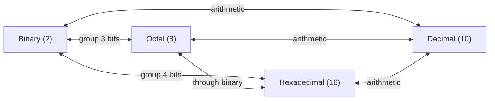

# 🔢 Base Conversion — Bits, Bytes and the Four Number Bases

> A from-zero guide to what numbers, bits and bytes really are, and how to convert between binary (2), octal (8), decimal (10) and hexadecimal (16), with one simple and one quick method for every direction. It is the foundation for XOR, DES, PIN blocks and MAC calculation in payment systems.

---

## Table of Contents

**Part A — Understanding (no math)**

1. [What Is a Number?](#1-what-is-a-number)
2. [Digits and Positions — The Odometer](#2-digits-and-positions--the-odometer)
3. [What Is a Base?](#3-what-is-a-base)
4. [What Is a Bit?](#4-what-is-a-bit)
5. [What Is a Byte?](#5-what-is-a-byte)
6. [Why These Four Bases?](#6-why-these-four-bases)
7. [Number or Data? — The Most Important Distinction](#7-number-or-data--the-most-important-distinction)

**Part B — The Math**

8. [Positional Notation](#8-positional-notation)
9. [Bases That Are Powers of Two](#9-bases-that-are-powers-of-two)

**Part C — Converting**

10. [The Conversion Map](#10-the-conversion-map)
11. [The Six Methods](#11-the-six-methods)
12. [From Binary](#12-from-binary)
13. [From Octal](#13-from-octal)
14. [From Decimal](#14-from-decimal)
15. [From Hexadecimal](#15-from-hexadecimal)

**Part D — In Code**

16. [Which Type Should a Conversion Return?](#16-which-type-should-a-conversion-return)
17. [Using the Library](#17-using-the-library)

**Part E — Reference**

18. [Cheat Sheet](#18-cheat-sheet)
19. [Practice](#19-practice)
20. [Conclusion](#20-conclusion)

---

# Part A — Understanding (no math)

## 1. What Is a Number?

Imagine a shepherd thousands of years ago who owns some sheep. They have no word for "seven" and no symbol `7`. Every morning, for each sheep that leaves the pen, they drop one pebble into a bag. Every evening, for each sheep that comes back, they take one pebble out. If a pebble is left, a sheep is missing.

The shepherd knows *how many* sheep they have without ever writing a number.

That is the key idea of this whole article:

- A **number** is an *amount*: how many sheep, how heavy, how far. It exists whether or not anyone writes it down.
- A **numeral** is the way we *write* that amount: `7`, `VII`, `111`, `٧`, `۷`, or seven pebbles.

The same amount can be written in many ways:

| Written as | System |
|---|---|
| `\|\|\|\|\|\|\|` | Tally marks |
| `VII` | Roman numerals |
| `7` | Decimal (Western digits) |
| `۷` | Decimal (Persian digits) |
| `111` | Binary |
| `7` | Octal |
| `7` | Hexadecimal |

Seven sheep are still seven sheep. Only the *picture* changes.

> [!IMPORTANT]
> Converting a number from one base to another **never changes the number**. It only changes how it is shown. A base is a user interface for an amount.

The same is true inside a computer. A computer does not store "214" or "D6". It stores a *pattern of switches*, and we choose how to show that pattern to humans.

---

## 2. Digits and Positions — The Odometer

Look at a car's odometer (the distance counter):

```text
┌───┬───┬───┐
│ 0 │ 9 │ 8 │
└───┴───┴───┘
```

Drive one more kilometre: the right wheel turns from 8 to 9. Drive one more: the right wheel has no digit after 9, so it goes back to 0 and **pushes the next wheel one step forward**:

```text
┌───┬───┬───┐       ┌───┬───┬───┐
│ 0 │ 9 │ 9 │  →→   │ 1 │ 0 │ 0 │
└───┴───┴───┘       └───┴───┴───┘
```

Two ideas hide in this machine:

1. **Digits:** each wheel has a fixed set of symbols (here `0`–`9`, ten of them).
2. **Positions:** a wheel further left is worth more. One step on the second wheel is worth ten steps on the first; one step on the third is worth ten steps on the second.

Now imagine an odometer whose wheels only have **two** symbols, `0` and `1`:

```text
000 → 001 → 010 → 011 → 100 → 101 → 110 → 111
```

It counts the same kilometres. It just rolls over much sooner. That is a **binary** odometer.

---

## 3. What Is a Base?

The **base** (also called **radix**) is **how many different digits each position has** — how many symbols are on each odometer wheel before it rolls over.

| Base | Name | Digits | Real-world example |
|---:|---|---|---|
| 2 | Binary | `0 1` | A light switch: off / on |
| 8 | Octal | `0 1 2 3 4 5 6 7` | Unix file permissions: `755` |
| 10 | Decimal | `0`–`9` | Our ten fingers; money, prices |
| 12 | Duodecimal | `0`–`9 A B` | A dozen eggs, 12 months, 12 hours on a clock face |
| 16 | Hexadecimal | `0`–`9 A B C D E F` | Colours `#FF8800`, MAC addresses, cryptographic keys |
| 60 | Sexagesimal | 60 symbols | 60 seconds = 1 minute, 60 minutes = 1 hour |

You already use more than one base every day without noticing. A clock is an odometer whose seconds and minutes wheels roll over at 60, not at 10:

```text
00:59  → one more minute →  01:00
```

Hexadecimal needs 16 symbols per position, but we only have ten digit shapes (`0`–`9`). So we borrow letters:

| Hex digit | `A` | `B` | `C` | `D` | `E` | `F` |
|---|---:|---:|---:|---:|---:|---:|
| Amount | 10 | 11 | 12 | 13 | 14 | 15 |

`A` is not a letter here. It is a single digit meaning "ten".

> [!NOTE]
> When a text mixes bases, we write the base as a small number after the digits: $214_{10}$, $11010110_2$, $326_8$, $D6_{16}$. Programmers use prefixes instead: `0b11010110`, `0o326`, `0xD6`. All four are the same amount.

---

## 4. What Is a Bit?

A **bit** (short for **bi**nary dig**it**) is the smallest possible piece of information: **one choice between two options**.

- On / off
- Yes / no
- True / false
- Current flows / does not flow
- Magnetised north / south
- Hole punched / not punched

We write those two options as `1` and `0`. That is all a bit is. The `0` and `1` are, again, only a picture; inside the chip it is a higher or lower voltage.

Why do computers use two options and not ten? Because telling **two** states apart is cheap, fast and reliable. A wire that is "clearly on" or "clearly off" survives noise, heat and ageing. Telling ten voltage levels apart would be fragile.

### What can bits do together?

One bit gives 2 possibilities. Each extra bit **doubles** them, because every old pattern can now end in `0` or in `1`:

| Bits | Patterns | Count |
|---:|---|---:|
| 1 | `0` `1` | 2 |
| 2 | `00` `01` `10` `11` | 4 |
| 3 | `000` `001` `010` `011` `100` `101` `110` `111` | 8 |
| 4 | … | 16 |
| 8 | … | 256 |

**Real-world example — a row of switches.** A hotel corridor has 8 rooms. The reception panel has one light per room: on = occupied. The whole corridor's state fits in 8 bits:

```text
Room:   1 2 3 4 5 6 7 8
Light:  1 1 0 1 0 1 1 0      → rooms 1, 2, 4, 6 and 7 are occupied
```

**Payment example — the ISO 8583 bitmap.** An ISO 8583 message starts with a bitmap: 64 bits, one per field. Bit *n* = `1` means "field *n* is present in this message". The bits are a *list of yes/no answers*, not an amount.

---

## 5. What Is a Byte?

A **byte** is a group of **8 bits**. It is the unit computers read, write, store and send.

```text
 bit:  7   6   5   4   3   2   1   0
     ┌───┬───┬───┬───┬───┬───┬───┬───┐
     │ 1 │ 1 │ 0 │ 1 │ 0 │ 1 │ 1 │ 0 │   one byte
     └───┴───┴───┴───┴───┴───┴───┴───┘
     └──── high nibble ┘ └── low nibble ┘
```

- 8 bits give $2^8 = 256$ patterns, so one byte can hold an amount from **0 to 255**.
- Half a byte (4 bits) is a **nibble**. A nibble has 16 patterns — exactly **one hexadecimal digit**. That is why every byte is written as exactly **two** hex digits (`00` to `FF`).
- Standards documents (ISO, IETF) often say **octet** instead of byte, to be explicit that it means 8 bits.

### A byte means whatever we agree it means

The byte `01010000` can be:

| Agreement | Meaning of `01010000` |
|---|---|
| Unsigned amount | 80 |
| ASCII character | the letter `P` |
| Part of a DES key | 8 key bits |
| Part of a bitmap | fields 2 and 4 present |
| Part of a PIN block | two nibbles: `5` and `0` |

The bits never change. Only the agreement does. This is why the [ANSI X9.19 MAC article](https://github.com/Mr-Alireza82/ANSI-X9.19-Retail-MAC-Algorithm) writes the text `PAYMENT123` as `5041594D454E54313233`: each pair of hex digits is one byte, and `50` is the byte of the letter `P`.

### Bigger units

| Unit | Size | Typical use |
|---|---|---|
| Bit | 1 | A flag, one bitmap position |
| Nibble | 4 bits | One hex digit, one BCD digit |
| Byte / octet | 8 bits | One ASCII character |
| DES block | 8 bytes = 64 bits | DES, Retail MAC, PIN block |
| AES block | 16 bytes = 128 bits | AES |
| Kilobyte (kB) | 1000 bytes | — |
| Kibibyte (KiB) | 1024 bytes | Memory sizes |

> [!NOTE]
> `kB` = 1000 and `KiB` = 1024 is the IEC 80000-13 naming. Many programs still write "KB" for 1024; when the exact size matters, write the bytes.

---

## 6. Why These Four Bases?

| Base | Who uses it | Why |
|---|---|---|
| 2 — Binary | The hardware itself | It is the real shape of the data: one digit per switch. Too long for humans to read. |
| 8 — Octal | Unix permissions, old computers | One digit = exactly 3 bits. Mostly historical today. |
| 10 — Decimal | Humans; amounts, STAN, TID, dates | Our everyday system. Does **not** line up with bits. |
| 16 — Hexadecimal | Programmers, payment specs, keys, MACs, dumps | One digit = exactly 4 bits, two digits = one byte. Short **and** lines up with bits. |

Hexadecimal is binary in shorthand. These two lines are the same 8 bytes; only one of them fits on a receipt:

```text
1000100111111010000110101010101000101100011011100010011111101101
89FA1AAA2C6E27ED
```

---

## 7. Number or Data? — The Most Important Distinction

Some digits are an **amount**. Other digits are a **label** or **raw data** that only happens to use digits.

**Real-world example — a phone number.** `09121234567` starts with `0`. Remove the zero and you dial someone else. Nobody adds two phone numbers together. A phone number is *data written with digits*, not an amount.

| Value | Number or data? | Leading zeros matter? |
|---|---|---|
| Transaction amount `1000` (minor units) | Number | No — `0001000` and `1000` are the same amount |
| ISO 8583 amount field `000000001000` | Number, written in a fixed width | The *field* needs 12 digits; the amount does not change |
| Terminal ID `00001234` | Data (a label) | **Yes** — `1234` is a different terminal |
| DES key `0123456789ABCDEF` | Data (8 bytes) | **Yes** — dropping `0` breaks the key |
| MAC `89FA1AAA2C6E27ED` | Data (8 bytes) | **Yes** |

This changes what a conversion is allowed to do:

```text
As a NUMBER:  00FF (hex) = 255 = FF          ← leading zeros vanish, nothing is lost
As DATA:      00FF (hex) = 2 bytes: 00, FF   ← the 00 byte is real information
```

> [!WARNING]
> Never convert keys, blocks, PIN blocks or MACs through "a number". A number forgets leading zeros, so an 8-byte key starting with `00` silently becomes 7 bytes. Treat them as **bytes** (see [§16](#16-which-type-should-a-conversion-return)).

---

# Part B — The Math

## 8. Positional Notation

Every position has a **weight**. The rightmost position has weight $1$; each position to the left is worth **base** times more.

For a number written with digits $d_{n-1} \dots d_2 \, d_1 \, d_0$ in base $b$:

$$\boxed{N = \sum_{i=0}^{n-1} d_i \cdot b^{\,i} = d_{n-1} b^{n-1} + \cdots + d_1 b^1 + d_0 b^0}$$

Where:

- $N$ is the number (the amount).
- $b$ is the base: 2, 8, 10 or 16.
- $d_i$ is the digit at position $i$, counted from the **right**, starting at **0**.
- Every digit satisfies $0 \le d_i \le b - 1$.
- $b^0 = 1$ for every base.

### Weights of the first positions

| Position $i$ | 7 | 6 | 5 | 4 | 3 | 2 | 1 | 0 |
|---|---:|---:|---:|---:|---:|---:|---:|---:|
| Base 2: $2^i$ | 128 | 64 | 32 | 16 | 8 | 4 | 2 | 1 |
| Base 8: $8^i$ | 2,097,152 | 262,144 | 32,768 | 4,096 | 512 | 64 | 8 | 1 |
| Base 10: $10^i$ | 10,000,000 | 1,000,000 | 100,000 | 10,000 | 1,000 | 100 | 10 | 1 |
| Base 16: $16^i$ | 268,435,456 | 16,777,216 | 1,048,576 | 65,536 | 4,096 | 256 | 16 | 1 |

### Example in our own base

$$214_{10} = 2 \cdot 10^2 + 1 \cdot 10^1 + 4 \cdot 10^0 = 200 + 10 + 4$$

We do this every day without thinking. Every other base works exactly the same way — only $b$ changes.

### The running example

Throughout Part C we convert one amount, **two hundred fourteen**, in every direction:

$$\boxed{11010110_2 = 326_8 = 214_{10} = D6_{16}}$$

### Useful facts

- With $n$ digits in base $b$ you can write $b^n$ different values: $0$ to $b^n - 1$.
- The largest $n$-digit number is all top digits: $11111111_2 = 255$, $FF_{16} = 255$, $999_{10} = 10^3 - 1$.
- Bits needed for a number $N > 0$: $\lfloor \log_2 N \rfloor + 1$. For $214$: $\lfloor 7.74 \rfloor + 1 = 8$ bits.

---

## 9. Bases That Are Powers of Two

$$8 = 2^3 \qquad\qquad 16 = 2^4 \qquad\qquad 10 \neq 2^k$$

Because $8 = 2^3$, **one octal digit holds exactly 3 bits**. Because $16 = 2^4$, **one hex digit holds exactly 4 bits**. So the positions line up perfectly:

```text
Binary:        1 1 0 1 0 1 1 0
               └──┬──┘ └──┬──┘
Hex (4 bits):     D       6

Binary:      0 1 1 0 1 0 1 1 0
             └─┬─┘ └─┬─┘ └─┬─┘
Octal (3 bits):3     2     6
```

Decimal has no such shortcut: $\log_2 10 \approx 3.32$ is not a whole number, so a decimal digit does not own a fixed group of bits. Changing the last decimal digit of a number can change bits anywhere. That is why conversions to and from decimal always need arithmetic, while conversions between 2, 8 and 16 need none.

---

# Part C — Converting

## 10. The Conversion Map



| From ↓ / To → | Binary | Octal | Decimal | Hexadecimal |
|---|---|---|---|---|
| **Binary** | — | [§12.1](#121-binary--octal) | [§12.2](#122-binary--decimal) | [§12.3](#123-binary--hexadecimal) |
| **Octal** | [§13.1](#131-octal--binary) | — | [§13.2](#132-octal--decimal) | [§13.3](#133-octal--hexadecimal) |
| **Decimal** | [§14.1](#141-decimal--binary) | [§14.2](#142-decimal--octal) | — | [§14.3](#143-decimal--hexadecimal) |
| **Hexadecimal** | [§15.1](#151-hexadecimal--binary) | [§15.2](#152-hexadecimal--octal) | [§15.3](#153-hexadecimal--decimal) | — |

## 11. The Six Methods

Every one of the 12 directions uses one of these. Learn the six, and you know all twelve.

| # | Method | Kind | Direction | Idea in one line |
|---|---|---|---|---|
| M1 | Sum of weights | Simple | any → 10 | Multiply each digit by its weight, add everything. |
| M2 | Horner's method | Quick | any → 10 | Left to right: *result × base + next digit*. |
| M3 | Subtract weights | Simple | 10 → any | Take away the biggest weight that fits, count how often. |
| M4 | Repeated division | Quick | 10 → any | Divide by the base; the remainders are the digits, read upwards. |
| M5 | Through decimal | Simple | any → any | M1 to reach decimal, then M3 to leave it. |
| M6 | Bit grouping | Quick | 2 ↔ 8 ↔ 16 | Swap each digit for its 3 or 4 bits, regroup. No arithmetic. |

<details>
<summary>Why does M2 (Horner) give the same result as M1?</summary>

Take a 3-digit number and factor out the base step by step:

$$d_2 b^2 + d_1 b + d_0 = \big( (d_2) \cdot b + d_1 \big) \cdot b + d_0$$

The right side is exactly "start with the first digit, multiply by the base, add the next digit, repeat". It needs no powers, only one multiplication and one addition per digit.

</details>

<details>
<summary>Why does M4 (repeated division) give the digits?</summary>

Write the number in positional form:

$$N = d_{n-1} b^{n-1} + \cdots + d_1 b + d_0 = b \cdot (\underbrace{d_{n-1} b^{n-2} + \cdots + d_1}_{q}) + d_0$$

So dividing $N$ by $b$ gives quotient $q$ and remainder $d_0$, the **last** digit (because $0 \le d_0 < b$). Dividing $q$ again gives $d_1$, and so on. The digits come out from right to left, which is why we read the remainders from the bottom up.

</details>

---

## 12. From Binary

### 12.1. Binary → Octal

**Simple (M5, through decimal):** $11010110_2 \xrightarrow{\text{M1}} 214_{10} \xrightarrow{\text{M3}} 326_8$ (see [§12.2](#122-binary--decimal) and [§14.2](#142-decimal--octal)).

**Quick (M6, group 3 bits):** split into groups of 3 **from the right**, pad the leftmost group with zeros, swap each group for its digit.

```text
Binary:        11010110
Groups of 3:   11 010 110
Padded:       011 010 110
Octal:          3   2   6        → 326
```

| 3 bits | `000` | `001` | `010` | `011` | `100` | `101` | `110` | `111` |
|---|---|---|---|---|---|---|---|---|
| Octal | 0 | 1 | 2 | 3 | 4 | 5 | 6 | 7 |

### 12.2. Binary → Decimal

**Simple (M1, sum of weights):** write the weights above the bits; add the weights wherever the bit is `1`.

```text
Weight:  128   64   32   16    8    4    2    1
Bit:       1    1    0    1    0    1    1    0

128 + 64 + 16 + 4 + 2 = 214
```

**Quick (M2, doubling):** start at 0. For each bit from the left: **double, then add the bit**.

```text
Bit:     1    1    0    1    0    1    1    0
Result:  1 →  3 →  6 → 13 → 26 → 53 → 107 → 214

(0×2+1=1, 1×2+1=3, 3×2+0=6, 6×2+1=13, 13×2+0=26, 26×2+1=53, 53×2+1=107, 107×2+0=214)
```

No weight table needed: this works in your head for any length.

### 12.3. Binary → Hexadecimal

**Simple (M5, through decimal):** $11010110_2 \xrightarrow{\text{M1}} 214_{10} \xrightarrow{\text{M3}} D6_{16}$.

**Quick (M6, group 4 bits):** groups of 4 from the right, pad on the left, swap each nibble.

```text
Binary:        11010110
Groups of 4:   1101 0110
Hex:              D    6        → D6
```

> [!TIP]
> To read a nibble fast, remember its weights **8 4 2 1**. `1101` = 8 + 4 + 1 = 13 = `D`.

---

## 13. From Octal

### 13.1. Octal → Binary

**Simple (M5, through decimal):** $326_8 \xrightarrow{\text{M1}} 214_{10} \xrightarrow{\text{M3}} 11010110_2$.

**Quick (M6):** replace **each** octal digit by exactly **3** bits (keep inner zeros!), then drop zeros at the very left.

```text
Octal:    3     2     6
Bits:   011   010   110
Joined: 011010110          → 11010110
```

### 13.2. Octal → Decimal

**Simple (M1):**

$$326_8 = 3 \cdot 8^2 + 2 \cdot 8^1 + 6 \cdot 8^0 = 192 + 16 + 6 = 214$$

**Quick (M2, Horner):** *result × 8 + next digit*.

```text
Digit:    3        2          6
Result:   3  →  3×8+2=26  →  26×8+6=214
```

### 13.3. Octal → Hexadecimal

**Simple (M5, through decimal):** $326_8 \xrightarrow{\text{M1}} 214_{10} \xrightarrow{\text{M3}} D6_{16}$.

**Quick (M6, through binary):** expand to 3-bit groups, then regroup by 4 from the right.

```text
Octal:            3   2   6
3-bit groups:   011 010 110
All bits:       011010110
4-bit groups:   0 1101 0110   → 0000 1101 0110
Hex:               0    D    6  → D6
```

---

## 14. From Decimal

### 14.1. Decimal → Binary

**Simple (M3, subtract weights):** list the powers of 2 up to the number. From the biggest: if it fits, write `1` and subtract; otherwise write `0`.

```text
Weight:   128   64   32   16    8    4    2    1
214-128=86 ✓
           86-64=22 ✓
                 22<32 ✗
                      22-16=6 ✓
                            6<8 ✗
                                6-4=2 ✓
                                     2-2=0 ✓
                                          0<1 ✗
Bits:       1    1    0    1    0    1    1    0      → 11010110
```

**Quick (M4, divide by 2):** divide, write the remainder, continue with the quotient until it is 0. **Read the remainders from bottom to top.**

```text
214 ÷ 2 = 107  remainder 0   ↑
107 ÷ 2 =  53  remainder 1   │
 53 ÷ 2 =  26  remainder 1   │
 26 ÷ 2 =  13  remainder 0   │  read upwards
 13 ÷ 2 =   6  remainder 1   │
  6 ÷ 2 =   3  remainder 0   │
  3 ÷ 2 =   1  remainder 1   │
  1 ÷ 2 =   0  remainder 1   │
                                → 11010110
```

### 14.2. Decimal → Octal

**Simple (M3):** weights 64, 8, 1. Count how many times each fits.

```text
214: 64 fits 3 times (192), left 22   → 3
 22:  8 fits 2 times  (16), left  6   → 2
  6:  1 fits 6 times   (6), left  0   → 6
                                        → 326
```

**Quick (M4, divide by 8):**

```text
214 ÷ 8 = 26  remainder 6   ↑
 26 ÷ 8 =  3  remainder 2   │
  3 ÷ 8 =  0  remainder 3   │
                              → 326
```

### 14.3. Decimal → Hexadecimal

**Simple (M3):** weights 256, 16, 1. 256 does not fit in 214.

```text
214: 16 fits 13 times (208), left 6   → 13 = D
  6:  1 fits  6 times   (6), left 0   → 6
                                        → D6
```

**Quick (M4, divide by 16):** remainders 10–15 become `A`–`F`.

```text
214 ÷ 16 = 13  remainder  6        ↑
 13 ÷ 16 =  0  remainder 13 = D    │
                                     → D6
```

> [!TIP]
> In practice, the fastest human route from decimal to hex is often decimal → binary (M4) → hex (M6), because grouping bits is error-free.

---

## 15. From Hexadecimal

### 15.1. Hexadecimal → Binary

**Simple (M5, through decimal):** $D6_{16} \xrightarrow{\text{M1}} 214_{10} \xrightarrow{\text{M3}} 11010110_2$.

**Quick (M6):** replace each hex digit by exactly **4** bits.

```text
Hex:      D      6
Bits:   1101   0110      → 11010110
```

This is the conversion you will do most often in payment work: every byte of a key, PIN block or MAC is two hex digits, i.e. two nibbles.

### 15.2. Hexadecimal → Octal

**Simple (M5, through decimal):** $D6_{16} \xrightarrow{\text{M1}} 214_{10} \xrightarrow{\text{M3}} 326_8$.

**Quick (M6, through binary):** expand to nibbles, then regroup by 3 from the right.

```text
Hex:             D    6
Nibbles:      1101 0110
All bits:     11010110
3-bit groups: 11 010 110  → 011 010 110
Octal:         3   2   6  → 326
```

### 15.3. Hexadecimal → Decimal

**Simple (M1):**

$$D6_{16} = 13 \cdot 16^1 + 6 \cdot 16^0 = 208 + 6 = 214$$

**Quick (M2, Horner):** *result × 16 + next digit*. With two digits it is the same calculation, so here is a longer one, `2F3`:

```text
Digit:    2          F (15)            3
Result:   2  →  2×16+15=47  →  47×16+3=755
```

Check with M1: $2 \cdot 256 + 15 \cdot 16 + 3 = 512 + 240 + 3 = 755$ ✓

---

# Part D — In Code

## 16. Which Type Should a Conversion Return?

Section 7 already answered this: it depends on whether the value is an **amount** or **data**. Each one gets its own type:

| What you have | Java type | Why |
|---|---|---|
| The amount itself | `BigInteger` | Any size, exact, no base at all. Base is only a display choice. |
| An amount written for people | `String` + `Base` | `"D6"` means nothing without knowing it is hexadecimal. |
| Data: keys, blocks, PIN blocks, MACs, messages | `byte[]` | Length is part of the value; leading zero bytes are kept. |

So the library has two families:

- **`BaseConversion`** — amounts. `String` ↔ `BigInteger` ↔ `String` in any of the four bases. Leading zeros are dropped, because they do not change an amount.
- **`ByteEncoding`** — data. `byte[]` ↔ hex text (2 digits per byte) or bit text (8 digits per byte). Nothing is ever dropped.

> [!CAUTION]
> Java's `byte` is **signed**: it shows the pattern `11111111` as `-1`, not `255`. The bits are the same; only Java's display differs. Use `ByteEncoding.unsigned(b)` (which is `b & 0xFF`) when you need 0–255.

## 17. Using the Library

Package `io.github.mralireza82.baseconversion`, pure Java 17, no dependencies.

| Class | Use it for |
|---|---|
| `Base` | The four bases: `BINARY`, `OCTAL`, `DECIMAL`, `HEXADECIMAL`. Digit values, bits per digit. |
| `BaseConversion` | **Amounts**, quick methods (M2, M4, M6). Use this in real code. |
| `SimpleConversion` | **Amounts**, simple methods (M1, M3, M5). For learning; same results. |
| `ByteEncoding` | **Data**: bytes ↔ hex / bits. |

```java
// Amounts
BaseConversion.convert("11010110", Base.BINARY, Base.HEXADECIMAL);  // "D6"
BaseConversion.convert("D6", Base.HEXADECIMAL, Base.OCTAL);         // "326"
BaseConversion.toNumber("326", Base.OCTAL);                         // BigInteger 214
BaseConversion.toDigits(BigInteger.valueOf(214), Base.BINARY);      // "11010110"
BaseConversion.convert("00FF", Base.HEXADECIMAL, Base.DECIMAL);     // "255"  (leading zeros are not an amount)

// The same with the paper-and-pencil methods
SimpleConversion.convert("D6", Base.HEXADECIMAL, Base.DECIMAL);     // "214"

// Data
byte[] key = ByteEncoding.fromHex("0123456789ABCDEF");              // 8 bytes, first one is 0x01
ByteEncoding.toHex(new byte[] {0x00, (byte) 0xFF});                 // "00FF" (both bytes kept)
ByteEncoding.toBits(new byte[] {(byte) 0xD6});                      // "11010110"
ByteEncoding.unsigned((byte) 0xD6);                                 // 214
```

**Input rules:**

- Upper- or lower-case hex digits are accepted; output is always upper case.
- Only digits: no sign, no spaces, no `0x` prefix. Wrong input throws `IllegalArgumentException` naming the bad digit.
- Amounts are zero or positive and may have any number of digits.
- Hex data needs an even number of digits; bit data a multiple of 8.

**How it is tested:** every conversion, in all 12 directions, is compared with the JDK's own `BigInteger` conversion for thousands of random numbers up to 200 bits, and the simple methods are compared with the quick ones.

**Run it yourself:** the code is in [`src/main/java`](src/main/java/io/github/mralireza82/baseconversion) and the tests in [`src/test/java`](src/test/java/io/github/mralireza82/baseconversion). With Java 17 or newer installed:

```bash
./gradlew test        # Windows: gradlew.bat test
```

**Use it in your project** (Gradle, through [JitPack](https://jitpack.io/#Mr-Alireza82/Base-Conversion)):

```kotlin
repositories {
    mavenCentral()
    maven("https://jitpack.io")
}

dependencies {
    implementation("com.github.Mr-Alireza82:Base-Conversion:v1.0.0")
}
```

---

# Part E — Reference

## 18. Cheat Sheet

### 0 to 16 in every base

| Decimal | Binary (4 bits) | Octal | Hex |
|---:|---:|---:|---:|
| 0 | `0000` | 0 | 0 |
| 1 | `0001` | 1 | 1 |
| 2 | `0010` | 2 | 2 |
| 3 | `0011` | 3 | 3 |
| 4 | `0100` | 4 | 4 |
| 5 | `0101` | 5 | 5 |
| 6 | `0110` | 6 | 6 |
| 7 | `0111` | 7 | 7 |
| 8 | `1000` | 10 | 8 |
| 9 | `1001` | 11 | 9 |
| 10 | `1010` | 12 | A |
| 11 | `1011` | 13 | B |
| 12 | `1100` | 14 | C |
| 13 | `1101` | 15 | D |
| 14 | `1110` | 16 | E |
| 15 | `1111` | 17 | F |
| 16 | `1 0000` | 20 | 10 |

### Powers of two worth remembering

| $2^n$ | Value | Where you meet it |
|---|---:|---|
| $2^4$ | 16 | Values of one nibble / hex digit |
| $2^8$ | 256 | Values of one byte |
| $2^{10}$ | 1,024 | One KiB |
| $2^{16}$ | 65,536 | Values of two bytes |
| $2^{56}$ | ≈ 7.2 × 10¹⁶ | Possible DES keys |
| $2^{64}$ | ≈ 1.8 × 10¹⁹ | Values of one DES block |

### Rules in one place

- **Any → decimal:** multiply each digit by its weight and add (M1), or *× base + digit* from the left (M2).
- **Decimal → any:** subtract the biggest weights (M3), or divide by the base and read remainders upwards (M4).
- **2 ↔ 16:** 4 bits per hex digit. **2 ↔ 8:** 3 bits per octal digit. **8 ↔ 16:** go through binary.
- **1 byte** = 8 bits = 2 hex digits = values 0–255.
- **Number** → leading zeros don't matter. **Data** → every digit matters.

---

## 19. Practice

Convert each one in both ways (simple and quick) and check that they agree.

1. $101101_2$ to decimal.
2. $45_{10}$ to hexadecimal.
3. $7F_{16}$ to binary and to octal.
4. $777_8$ to decimal and to hexadecimal.
5. How many bytes is the hex text `0123456789ABCDEF`? How many bits?
6. Why must a DES key never be converted with `BaseConversion`?

<details>
<summary>Answers</summary>

1. $32 + 8 + 4 + 1 = 45$. Doubling: 1, 2, 5, 11, 22, 45.
2. $45 \div 16 = 2$ remainder $13$ → `2D`.
3. `7` → `0111`, `F` → `1111` → $1111111_2$. Regroup by 3: `1 111 111` → $177_8$.
4. $7 \cdot 64 + 7 \cdot 8 + 7 = 511$. Bits: `111 111 111` → regroup by 4: `1 1111 1111` → $1FF_{16}$.
5. 16 hex digits ÷ 2 = **8 bytes** = **64 bits** — exactly one DES block.
6. A key is data, not an amount. `BaseConversion` drops leading zeros (`00…` keys would lose bytes) and has no notion of length. Use `ByteEncoding.fromHex`.

</details>

---

## 20. Conclusion

- A **number** is an amount; a **base** is only the way it is written. Converting never changes the amount.
- A **bit** is one yes/no choice; a **byte** is 8 bits with 256 patterns, and its meaning comes from an agreement (amount, letter, key, flags).
- **Positional notation** — $N = \sum d_i b^i$ — is the single rule behind all four bases.
- Between 2, 8 and 16 you only **regroup bits**; to and from 10 you need **arithmetic** (Horner, repeated division).
- Keep **amounts** and **data** apart: amounts drop leading zeros, data never does.

With bits, bytes and hex in hand, the next step is the first real operation on them: **XOR**.

---

## References and Further Reading

- IEC 80000-13 — Quantities and units, Part 13: Information science and technology (bit, byte, octet, KiB)
- Donald E. Knuth, *The Art of Computer Programming*, Vol. 2, §4.1 — Positional Number Systems
- [Java SE 17 — `BigInteger`](https://docs.oracle.com/en/java/javase/17/docs/api/java.base/java/math/BigInteger.html)
- [GitHub — Basic Writing and Formatting Syntax](https://docs.github.com/en/get-started/writing-on-github/getting-started-with-writing-and-formatting-on-github/basic-writing-and-formatting-syntax)

**Related articles:**

- [XOR — Exclusive OR](https://github.com/Mr-Alireza82/XOR) *(next)*
- [DES and Triple DES — Data Encryption Standard](https://github.com/Mr-Alireza82/DES)
- DES — Data Encryption Standard *(planned)*
- [ANSI X9.19 — Retail MAC Algorithm](https://github.com/Mr-Alireza82/ANSI-X9.19-Retail-MAC-Algorithm)

---

## License

[MIT](LICENSE) — free to use, copy, modify and share, including commercially. Keep the copyright notice.
